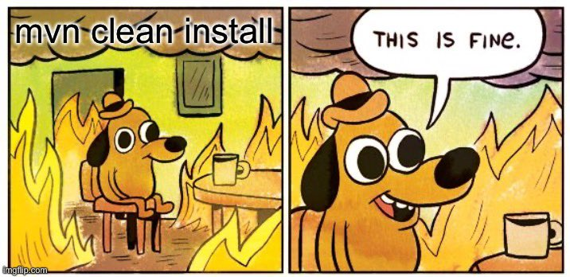
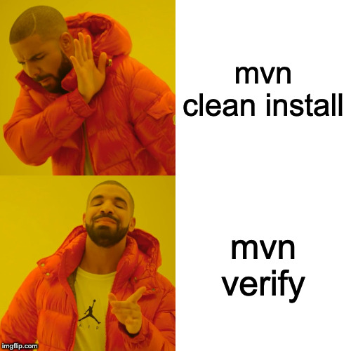
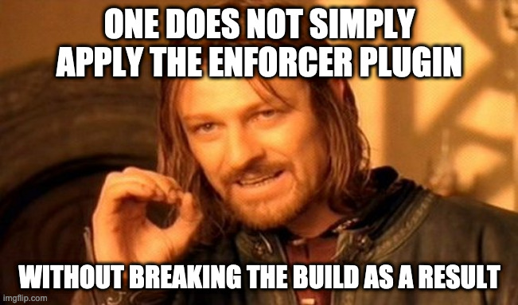
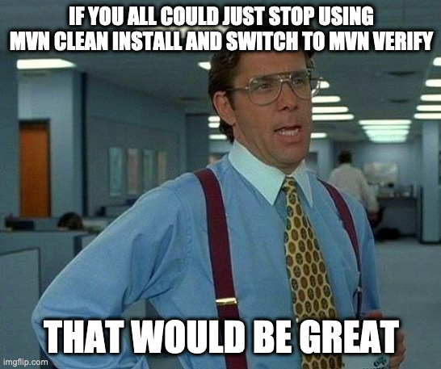
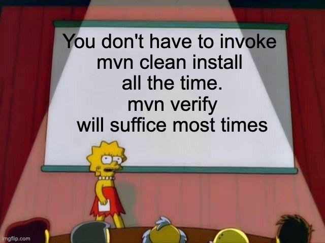

# Maven 4 Migration: A Practical Guide to Smooth Upgrades

<!-- TOC -->
* [Maven 4 Migration: A Practical Guide to Smooth Upgrades](#maven-4-migration-a-practical-guide-to-smooth-upgrades)
  * [Why This Guide](#why-this-guide)
  * [What is New in Maven 4](#what-is-new-in-maven-4)
  * [Migration to Maven 4](#migration-to-maven-4)
    * [Quick Overview](#quick-overview)
    * [Prerequisites for Maven 4](#prerequisites-for-maven-4)
    * [Installing Maven 4](#installing-maven-4)
    * [Maven Upgrade Tool](#maven-upgrade-tool)
    * [Build with Maven 4](#build-with-maven-4)
    * [Troubleshooting](#troubleshooting)
    * [Warnings](#warnings)
  * [Adopt New Features of Maven 4](#adopt-new-features-of-maven-4)
    * [Switch to POM model version 4.1.0](#switch-to-pom-model-version-410)
    * [Some new Maven 4 features](#some-new-maven-4-features)
  * [Conclusion](#conclusion)
  * [License & Attribution](#license--attribution)
<!-- TOC -->

## Why This Guide

Maven, as one of the leading build tools, has continuously evolved over the past 20 years to meet the changing
requirements of the IT industry. With the upcoming release of Maven 4, lots of projects face the exciting challenge of
migration and taking advantage of the new features and improvements. This guide aims to help seasoned Java developers to
minimize upgrade effort, identify potential challenges early, and future-proof their projects.

**

## What is New in Maven 4

Maven 4 is a major release with many significant [changes](https://maven.apache.org/whatsnewinmaven4.html). Some of them
are:

- **Required Java Version:** Maven 4 requires Java 17 to run. This refers to the JDK used to execute Maven itself, not
  the JDK used to compile project source code, which remains independent and can be any version supported by your
  project.

- **Separation of POMs:** Maven 4 distinguishes between the build POM and the consumer POM. When consumer-POM flattening
  is enabled, the consumer POM is simplified for downstream projects, while build-specific configuration is omitted from
  that POM. This can reduce unnecessary exposure of build configuration, although the full build POM is also published
  separately.

- **Updated POM Model Version:** Maven 4 adds a new POM schema version 4.1.0, that brings additional configuration
  options while marking legacy elements as deprecated. All existing 4.0.0 POMs continue to work without any changes,
  so upgrading the model version is only necessary when Maven 4-specific features are needed.

- **Renaming of Modules:** The term `module` has been changed to `subproject` to enable a clearer understanding of
  project organization, especially in multi-project setups.

- **Automatic Versioning:** Maven 4 supports automatic versioning of parents and subprojects in multi-project setups,
  simplifying version management, for example, during installation or deployment.

- **New Packaging Type BOM:** Bills of Materials (BOMs) are now treated as first-class citizens, enabling better
  management of transitive dependencies, including the ability to exclude them.

- **Improved CI/CD Integration:** Maven 4 supports out-of-the-box the CI-friendly variables like `${revision}`,
  facilitating integration into CI/CD pipelines and reducing configuration overhead.

- **"Fail on Severity" Parameter:** The new `--fail-on-severity` (or `-fos`) flag allows setting a log
  level threshold that automatically fails the build. This is useful in CI/CD pipelines where warnings or errors
  should be treated as hard stop conditions.

- **Improvements to Profiles:** Maven 4 now enforces stricter profile validation: activating a profile that doesn't
  exist will fail the build, helping catch typos and misconfigurations early. For optional profiles that may
  not be present in every module, appending a `?` to the profile name makes activation conditional.

- **Lifecycle changes**
  - **Lifecycle changed from graph to tree:** Since in Maven 4 the lifecycle is defined as a tree of phases you can run
    `deploy` without `install`, which was not possible in Maven 3 with linear lifecycle
  - **New `before:` and `after:` phases, Execution Order:** Maven 4 adds hook phases `before:` and `after:`
    to each standard lifecycle step, giving finer control over execution timing. For instance, fixtures can be
    prepared in `before:integration-test` and cleaned up in `after:integration-test`. When several plugin goals need to
    run in a specific order within the same phase, a numeric priority in square brackets, such as
    `before:integration-test[100]` and `before:integration-test[200]`, defines the sequence explicitly.

## Migration to Maven 4

### Quick Overview

In short, the general recommendation for [migration](https://maven.apache.org/guides/mini/guide-migration-to-mvn4.html)
is to do it in the following steps:

- Meet prerequisites for Maven 4 migration.
- Install Maven 4 and, if used, update Maven Wrapper as well as custom Maven configurations.
- Build with Maven 4 and fix errors and warnings.
- If necessary, adjust CI/CD configurations and pipelines.
- Use desired new Maven 4 features.

To make the migration as practical as possible, an
existing [Spring Boot Java Microservice](https://github.com/mirogaudi/product-catalog-service) repository is used as a
guinea pig.

💡 **Note:** The necessary installations are done with [SDKMAN!](https://sdkman.io/). Alternatively you can use any other
suitable tool of your choice, for example [mise-en-place](https://mise.jdx.dev/).

### Prerequisites for Maven 4

To prepare a project for migration to Maven 4, the following prerequisites should be met:

- **The latest version of Maven 3 is used**

  If a project uses Maven Wrapper, it must likewise be brought to the latest Maven 3 version. The following shell
  commands can be useful:

  ```shell
  # check available Maven 3 versions with SDKMAN!
  sdk list maven | grep '3\.10\.'
  ```

  ```shell
  # install and use the latest Maven 3 version with SDKMAN!
  sdk install maven 3.10.0 && sdk use maven 3.10.0
  ```

  ```shell
  # update Maven wrapper respectively
  mvn wrapper:wrapper -Dmaven=3.10.0
  ```

- **The latest Maven 3 versions of plugins are used**

  ⚠️ **Note:** Do not update to plugin versions that require Maven 4!
  Be careful if such automated updates are performed, for example, with Dependabot or Renovate!
  To check the available versions of plugins
  with [versions-maven-plugin](https://www.mojohaus.org/versions/versions-maven-plugin/index.html), the following shell
  command can be used:

  ```shell
  # check available plugin versions with versions-maven-plugin
  mvn versions:display-plugin-updates
  ```

- **The project builds with the latest Maven 3 without errors or warnings**

  🚀 **Recommendation**: _"Do not use `mvn clean install` for your regular builds. Instead, use `mvn verify`!"_ - Apache
  Maven

**

### Installing Maven 4

To be able to use Maven 4, the following should be done:

- **Install JDK 17 or newer**

  Maven 4 requires Java 17, so JDK 17 or newer depending on what your project needs should be installed for the build
  environment.

  ```shell
  # check available JDK 17 Temurin versions with SDKMAN!
  sdk list java | grep '17\..*-tem'
  ```

  ```shell
  # install and use the latest JDK 17 Temurin with SDKMAN!
  sdk install java 17.0.21.0+9-tem && sdk use java 17.0.21.0+9-tem
  ```

- **Install Maven 4 (release candidate)**

  ⚠️ **Note:** Be aware that as of November 2026 only a release
  candidate [Maven 4.0.0-rc-7](https://github.com/apache/maven/releases/tag/maven-4.0.0-rc-7) is available being the
  last version before the Maven 4.0.0 GA release!

  If a project uses Maven Wrapper, make sure it also uses Maven 4. The following shell commands can be useful:

  ```shell
  # check available Maven 4 versions with SDKMAN!
  sdk list maven | grep '4\.'
  ```

  ```shell
  # install and use the latest Maven 4 version with SDKMAN!
  sdk install maven 4.0.0-rc-7 && sdk use maven 4.0.0-rc-7
  ```

  ```shell
  # update Maven wrapper to use Maven 4.0.0-rc-7
  ./mvnw wrapper:wrapper -Dmaven=4.0.0-rc-7
  ```

- **Use Maven 4 versions of plugins**

  To check the available versions of plugins
  with [versions-maven-plugin](https://www.mojohaus.org/versions/versions-maven-plugin/index.html), the following shell
  command can be used:

  ```shell
  # check available plugin versions with versions-maven-plugin
  mvn versions:display-plugin-updates
  ```
  Some specific minimum plugin versions required for Maven 4 compatibility:

| Plugin                | Min Version | Reason                                                                      |
|-----------------------|-------------|-----------------------------------------------------------------------------|
| maven-enforcer-plugin | ≥ 3.0.0     | Older versions use removed `PluginParameterExpressionEvaluator constructor` |
| exec-maven-plugin     | ≥ 3.2.0     | Older versions call `MavenSession.getContainer()` which returns null        |
| maven-compiler-plugin | ≥ 3.11      | Older versions can't find `ErrorProne` under Maven 4 classloading           |

💡 **Note:** Since Maven 4.0.0-rc4 you can also use the [Maven Upgrade Tool](https://maven.apache.org/tools/mvnup.html)
for it. For details see [below](#maven-upgrade-tool).

- **Optional: Update the Maven Enforcer Plugin configuration**

  If the project uses [maven-enforcer-plugin](https://maven.apache.org/enforcer/maven-enforcer-plugin/), its
  configuration should be adjusted accordingly:

  ```xml
  <plugin>
    <groupId>org.apache.maven.plugins</groupId>
    <artifactId>maven-enforcer-plugin</artifactId>
    <executions>
      <execution>
        <id>enforce-versions</id>
        <goals>
          <goal>enforce</goal>
        </goals>
        <configuration>
          <rules>
            <requireMavenVersion>
              <!-- require Maven version from 4.0.0-rc upwards -->
              <version>[4.0.0-rc,)</version>
            </requireMavenVersion>
            ...
          </rules>
        </configuration>
      </execution>
    </executions>
  </plugin>
  ```

**

- **Optional: Update custom Maven settings**

  If custom project or user level Maven settings are used, they must also be updated according to Maven 4 installation
  settings. Whether and which Maven settings files are used can be checked with the following shell command:

  ```shell
  # list all used Maven settings
  mvn -X clean | grep 'settings from'
  ```

### Maven Upgrade Tool

Since the version 4.0.0-rc4 Maven shipped with the [Maven Upgrade Tool](https://maven.apache.org/tools/mvnup.html) which
makes upgrade of your project POMs to Maven 4 significantly easier. Just try the following commands:

```shell
# check if an upgrade of the pom.xml files is possible
mvnup check
```

```shell
# apply available upgrades
mvnup apply
```

This should fix most of the common issues like:

- Duplicate plugins/dependencies
- Duplicate XML elements (`<groupId>`, `<artifactId>`, etc.)
- Incorrect `parent.relativePath` pointing to non-existent POMs
- Deprecated phase names

### Build with Maven 4

Once Maven 4 is installed and ready, the project should be built with Maven 4. All errors and warnings that occur should
be fixed.

To avoid missing warnings, the `--fail-on-severity` build parameter can be used with Maven 4:

```shell
# build failing on warnings
mvn --fail-on-severity WARN verify
```

To enable the concurrent builder, the `--builder concurrent` build parameter can be used with Maven 4:

```shell
# build enabling concurrent builder
mvn --fail-on-severity WARN -b concurrent verify
```

⚠️ **Note:** If necessary, adjust also CI/CD configurations and pipelines!

**Friendly Reminder:** _"Do not use `mvn clean install` for your regular builds. Instead, use `mvn verify`!"_ - Apache
Maven

**

### Troubleshooting

If you did not use the [Maven Upgrade Tool](#maven-upgrade-tool), or it failed to upgrade your project, or you just want
to upgrade your POMs manually, then consider to do some required changes if the situation applies to your project:

- 🚨**`installAtEnd`/`deployAtEnd` Breaking Change**
  In Maven 4 both the Maven Install Plugin and Maven Deploy Plugin now default `installAtEnd` and `deployAtEnd` to
  `true`. This affects build order for multi-module projects. Fix your configuration in case your build relies on the
  old default value `false`!

- **Remove duplicate plugin/dependency declaration**
  In case some of your POMs contain a duplicate plugin or dependency declaration you will get one of the following
  errors:

  ```shell
  [ERROR] 'build.plugins.plugin.(groupId:artifactId)' must be unique but found duplicate declaration of plugin ...
  ```

  ```shell
  [ERROR] 'dependencies.dependency.(groupId:artifactId:type:classifier)' must be unique: ...
  ```
  To fix it just remove the duplicates.

- **Replace removed properties**

| Removed or Deprecated in Maven 4       | Replace with               |
|----------------------------------------|----------------------------|
| `${session.executionRootDirectory}`    | `${session.rootDirectory}` |
| `${maven.multiModuleProjectDirectory}` | `${project.rootDirectory}` |

⚠️ **Note:** To be able to use the property `project.rootDirectory`, the root directory of the project should be
defined. For example, by creating the `.mvn` folder there.

- **Replace the conceptual `pre-` and `post-` lifecycle phases**

  Since in Maven 3 `integration-test`, `clean` and `test` lifecycle phases can have `pre-` and `post-` phases they need
  to be replaced with Maven 4 `before:` and `after:` phases:

| Maven 3        | Maven 4          |
|----------------|------------------|
| `pre-<phase>`  | `before:<phase>` |
| `post-<phase>` | `after:<phase>`  |

⚠️ **Note:** To be able to use `before:` and `after:` phases you need
to [switch to POM model version 4.1.0](#switch-to-pom-model-version-410)!

### Warnings

Some of the warnings that may occur include:

- "OpenJDK 64-Bit Server VM warning" (Sharing is only supported for boot loader classes):

  ```shell
  [WARNING] [stderr] OpenJDK 64-Bit Server VM warning: Sharing is only supported for boot loader classes 
    because bootstrap classpath has been appended
  ```

  A possible solution is to disable sharing during tests in your project's `pom.xml`:

  ```xml
  <properties>
    ...
    <!-- required for later replacement of argLine -->
    <argLine/>
  </properties>
  ```

  ```xml
  <plugin>
    <groupId>org.apache.maven.plugins</groupId>
    <artifactId>maven-surefire-plugin</artifactId>
    <configuration>
      ...
      <argLine>@{argLine} -Xshare:off</argLine>
    </configuration>
  </plugin>
  ```

## Adopt New Features of Maven 4

Maven 4 generally does not require the new POM model version 4.1.0, unless you want to use the new POM features like
`root` attribute, automatic versioning in multi subprojects setups, new lifecycle phases, optional profiles and others.

### Switch to POM model version 4.1.0

To switch project POMs to the new POM model version 4.1.0, the following header should be used:

  ```xml

<project xmlns="http://maven.apache.org/POM/4.1.0"
         xmlns:xsi="http://www.w3.org/2001/XMLSchema-instance"
         xsi:schemaLocation="http://maven.apache.org/POM/4.1.0 https://maven.apache.org/xsd/maven-4.1.0.xsd">
  <modelVersion>4.1.0</modelVersion>
  ...
</project>
  ```

💡 **Note:** Since Maven 4.0.0-rc4 you can also use the [Maven Upgrade Tool](https://maven.apache.org/tools/mvnup.html)
for it.

❌ **Note:** In case your project uses [Renovate]([Renovate](https://github.com/renovatebot/renovate)) for dependency
updates, then be aware, that as of November 2026 it does not support Maven 4 POM model version 4.1.0! For details
see [here](https://github.com/renovatebot/renovate/discussions/41734).

```shell
# check if upgrade to model version 4.1.0 is possible
mvnup check --model-version 4.1.0
```

```shell
# upgrade to model version 4.1.0
mvnup apply --model-version 4.1.0
```

### Some new Maven 4 features

Some Maven 4 features that can be used with POM model version 4.1.0:

- **Subprojects instead of Modules**:

  ```xml
  <!-- Maven 3 or 4 with modelVersion 4.0.0 -->
  <modules>
    <module>ModuleA</module>
    <module>ModuleB</module>
  </modules>
  ```

  ```xml
  <!-- Maven 4, requires modelVersion 4.1.0 -->
  <subprojects>
    <subproject>ModuleA</subproject>
    <subproject>ModuleB</subproject>
  </subprojects>
  ```

- **Automatic Versioning in multi-project setups:**
  In Maven 3 with the POM model version 4.0.0, the versioning of the parent and subprojects is mandatory:

  ```xml
  <project xmlns="http://maven.apache.org/POM/4.0.0"
           xmlns:xsi="http://www.w3.org/2001/XMLSchema-instance"
           xsi:schemaLocation="http://maven.apache.org/POM/4.0.0 http://maven.apache.org/xsd/maven-4.0.0.xsd">
    <modelVersion>4.0.0</modelVersion>
  
    <artifactId>subproject1</artifactId>
  
    <parent>
      <groupId>foo.bar</groupId>
      <artifactId>ParentProject</artifactId>
      <!-- parent version must be hardcoded -->
      <version>0.0.1-SNAPSHOT</version>
    </parent>
  
    <dependencies>
      <dependency>
        <groupId>foo.bar</groupId>
        <artifactId>subproject2</artifactId>
        <!-- subproject version may use project.version property -->
        <version>${project.version}</version>
      </dependency>
    </dependencies>
  </project>
  ```
  In Maven 4 with the POM model version 4.1.0, the versioning and coordinates of the parent and the versioning of
  subproject can be omitted:

  ```xml
  <project xmlns="http://maven.apache.org/POM/4.1.0"
           xmlns:xsi="http://www.w3.org/2001/XMLSchema-instance"
           xsi:schemaLocation="http://maven.apache.org/POM/4.1.0 https://maven.apache.org/xsd/maven-4.1.0.xsd">
    <modelVersion>4.1.0</modelVersion>
  
    <artifactId>subproject1</artifactId>
  
    <parent/>
  
    <dependencies>
      <dependency>
        <groupId>foo.bar</groupId>
        <artifactId>subproject2</artifactId>
      </dependency>
    </dependencies>
  </project>
  ```

- **CI-friendly Variables without `flatten-maven-plugin`**
  Thanks to the improved dependency resolution of own dependencies in multi-project setups, the CI-friendly variables
  (such as `${revision}`, `${sha1}`, and `${changelist}`) are now fully supported when automatic versioning is used.
  This also means that the [flatten-maven-plugin](https://www.mojohaus.org/flatten-maven-plugin/) is no longer needed.

- **BOM Packaging**:
  Maven 4 introduces a special BOM packaging type to provide a Bill of Materials (BOM):

  ```xml
  <packaging>bom</packaging>
  ```

- **The new `all` and `each` life cycle phases**

  In Maven 4 you can use the new `all` and `each` lifecycle phases if you want to execute a plugin before or after all
  or each of your (sub-)projects, for example:
  - `before:all`
  - `after:all`
  - `before:each`
  - `after:each`

- New `<sources>` element to declare source code directories:

  In Maven 3 to define custom source code directories you can use `<sourceDirectory>` and `<testSourceDirectory>`:

  ```xml
  <project>
    <build>
      <sourceDirectory>some-dir/foo</sourceDirectory>
      <testSourceDirectory>some-dir/bar</testSourceDirectory>
    </build>
  </project>
  ```

  In Maven 4 you should use `<sources>` element for it:

  ```xml
  <project>
    <build>
      <sources>
        <source>
          <scope>main</scope>
          <directory>some-dir/foo</directory>
        </source>
        <source>
          <scope>test</scope>
          <directory>some-dir/bar</directory>
        </source>
      </sources>
    </build>
  </project>
  ```

## Conclusion

The migration to Maven 4 represents a significant advancement in build automation. With the introduction of new features
such as the separation of Build-POM and Consumer-POM, automatic versioning in multi-project setups, BOM packaging, and
improved CI/CD integration, the handling of dependencies and project organization is considerably simplified.

Although migration requires careful planning and preparation, as well as the early identification of potential
challenges, it still can be carried out smoothly by implementing the steps described above.

The numerous new features and improvements, including a performance boost and a clearer project model, make the upgrade
worthwhile for most of the projects.

Overall, the migration to Maven 4 offers you not only a significant opportunity to adopt a future-proof solution, but
also a good opportunity to modernize and optimize your build processes and increase productivity.

**Extra Take-Away:** _"Do not use `mvn clean install` for your regular builds. Instead, use `mvn verify`!"_ - Apache
Maven

**

---

## License & Attribution

This guide is licensed under [CC BY-SA 4.0](https://creativecommons.org/licenses/by-sa/4.0/).

Maven memes by [Andres Almiray](https://github.com/aalmiray/mvn-clean-install), used
under [CC BY-SA 4.0](https://creativecommons.org/licenses/by-sa/4.0/).
